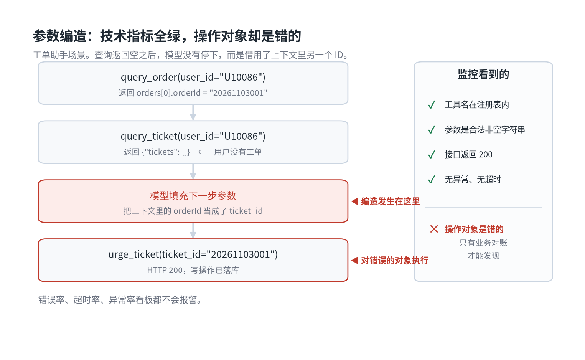
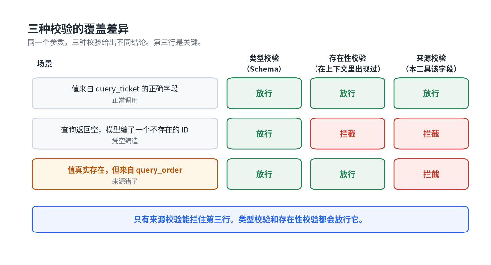

# Schema 全绿，Agent 却把参数编造了

改了 Prompt，你敢直接发到生产吗？

如果答案是"不敢，先人工看几十条 case"，那这篇讲的这类故障，人工看 case 大概率也看不出来——因为它每一步在技术上都是成功的。

先看它长什么样。

Agent 要查一条记录，查询接口返回空。这时候正确的行为是告诉用户没查到。但模型没有停，它从上下文里挑了另一个数字型字段填进下一步的参数，继续往下执行。

工具名是对的，参数类型是对的，接口返回 200。整条调用链在监控上看不出任何异常。

出错的是这个参数的来源。

我们把这类问题单独归成一类，叫**参数编造**。它不在常见的幻觉分类里，而它的后果比大部分能被分类抓到的幻觉都严重。



图 1　技术指标全绿，但操作对象是错的

## 现有的分类为什么抓不到它

流传最广的那套幻觉分类是内容层的四种：事实性、忠实性、推理性、自我矛盾。它们关心的是输出内容错没错。

参数编造的输出内容可能完全正确。它只是作用在了错误的对象上。你拿事实性幻觉的检测方法去查，查不出问题——模型说的每句话都成立，只是那句话说的不是这条记录。

学术界的分法更接近一些。MIRAGE-Bench 把智能体幻觉分成三类：动作对任务指令不忠实、对执行历史不忠实、对环境观察不忠实。这个框架已经在看动作而不只是看文本了，但参数编造仍然没有独立的位置。

它既不是没听指令，也不是记错了历史，也不是误读了观察结果。模型准确地读到了"查询结果为空"这个观察，然后选择了一个错误的应对方式。问题出在观察和行动之间那一步，而现有分类没有覆盖这一步。

## 类型匹配和语义匹配是两件事

模型做槽位填充时，优先满足的是格式约束。

参数定义写着 `ticket_id: string`，注意力就落在"这里需要一个字符串 ID"上。当目标值不存在时，它不会承认缺失，而会从上下文里找一个形状匹配的值补上。上下文里从来不缺数字：用户 ID、会话 ID、上一个查询返回的业务 ID，形状全都对得上。

Schema 管的是形状。它没有办法表达"这个值必须来自哪里"。

这就是这类故障的根。它不是模型能力不足，恰恰相反，是模型太擅长把不完整的输入补成一个看起来完整的调用。

## 它在技术层面是成功的

这类故障最麻烦的地方在于，所有技术指标都是绿的。

调用成功，状态码正常，返回体结构完整。基于错误率、超时率、异常率的监控不会报警。链路追踪里也看不到红色节点。

发现它的唯一途径是业务对账——有人发现被操作的那条记录跟自己无关。而这个时候，写操作已经落库了。

查询错了只是答错一句话。写错了会产生一条不该存在的记录，或者对一个错误的对象执行了动作。前者可以澄清，后者要回滚，有些还回滚不了。

## 检测：给参数做溯源

检测思路很直接：每个受约束的参数，值必须能追溯到上下文中一个明确的来源字段。

具体说，就是回答这个问题——这个 `ticket_id` 的值，是哪一次工具调用、返回体里哪个路径上的值？答不出来，就判定为编造。

下面是示意的校验逻辑：

```python
def check_provenance(call, trace):
    rules = SOURCE_WHITELIST.get(call.tool, {})
    for name, value in call.args.items():
        rule = rules.get(name)
        if rule is None:
            continue
        # 值必须真实出现在指定工具的指定返回路径上
        if not value_exists_at(trace, rule.tool, rule.path, value):
            return Fail(
                type="PARAM_FABRICATION",
                param=name,
                value=value,
                expected_source=f"{rule.tool}.{rule.path}",
            )
    return Pass()
```

这段逻辑里没有模型参与。它是纯规则校验，成本接近零，可以挂在每一次工具调用上，也可以离线跑在历史 trace 上。

## 治理：四层防线

### 第一层，字段级来源白名单

不要只做类型校验，要把约束下探到来源。示意配置：

```yaml
tools:
  urge_ticket:
    params:
      ticket_id:
        type: string
        source:                      # 关键在这里
          tool: query_ticket
          path: data.tickets[].ticketId
        on_missing: abort_and_clarify
```

`on_missing` 那一行同样重要。来源找不到时的行为必须是终止并澄清，而不是让模型自己想办法。

### 第二层，前置查询强制化，参数用引用而不是值

调用写操作之前，必须存在一次成功的查询。这一条用流程约束来保证，不交给模型判断。

更彻底的做法是让模型不生成值，只生成引用：

```json
{
  "tool": "urge_ticket",
  "args": {
    "ticket_id": { "$ref": "steps[1].data.tickets[0].ticketId" }
  }
}
```

执行引擎负责解引用。模型给出的是路径，不是 ID 本身。它没有机会编造，因为这一次它手里没有笔。

这个改动看起来只是换了个传参形式，实际是把"值的产生权"从模型手里收回到了引擎手里。

### 第三层，服务端独立校验

前面两层都在 Agent 侧。服务端要再查一遍：参数指向的对象，是否属于当前会话的上下文范围。

不要依赖调用方自觉。Agent 侧的约束可能因为一次 Prompt 改动、一次模型升级、一次工具描述更新而失效，服务端这一层不会。

### 第四层，高风险动作回显确认

涉及不可逆写操作的，把解析出来的关键参数回显给用户确认再执行。

这一层有体验成本，所以只用在高风险动作上。查询和解读不需要，涉及资金、状态变更、对外通知的需要。这样分级是为了把防护成本用在真正需要的地方。

## 为什么 strict JSON Schema 解决不了这件事

结构化输出和 strict 模式能保证参数符合 schema，这很有用，但它解决的是另一个问题。

你可以规定 `ticket_id` 必须是字符串、必须匹配某个正则、必须非空。你没有办法用 schema 规定"这个值必须来自上一步查询的返回"。来源约束不在 schema 的表达能力之内。

所以这层校验只能放在 schema 之外，放在执行引擎里。指望升级一个更强的模型或者打开 strict 模式就能解决，方向就错了。

还有一个更容易被忽略的中间档。有人会想，那我退一步，校验「这个 ID 在上下文里出现过」不就行了？

不行。上下文里确实有那个 orderId，它是真实存在的值，只是来自另一个工具。存在性校验会放行它。

三种校验的覆盖范围不一样，差别就在这一行：



图 2　只有来源校验能拦住第三行

## 怎么构造能抓到它的测试集

正常的测试集抓不到这类问题。因为正常用例里目标记录都存在，模型不需要编造。

要专门构造对抗用例：**上下文里放多个数字型字段，同时让目标查询返回空。**

这一个构造条件就能把这类故障暴露出来。类似的构造还有：上下文里放两条相似记录但只有一条符合条件、查询返回部分字段缺失、多轮会话中途切换实体。

这些用例在评测集里的占比不用高，但必须有。没有它们，你的评测通过率再高也不说明问题。

## 一个关于成本的观察

这类幻觉的检测成本很低，这一点值得单独说。

把幻觉按可判定性分类之后会发现，相当一部分可以用规则直接抓：工具名不在注册表、工具返回错误但回复声称成功、参数找不到来源、结论引用的实体和当前实体不一致。这些都不需要模型参与。

只有语义模糊的边界情况才需要上模型判卷。

所以评测成本居高不下的系统，问题常常不在判卷模型选得贵，而在分类粒度太粗。分类粗，就只能把所有样本都丢给大模型去判断。把分类做细，成本结构会跟着变。

## 最后

我们习惯校验参数的形状，很少校验参数的出身。

形状是 schema 的事，已经有很多现成工具。出身是执行引擎的事，基本上得自己建。

在只负责回答问题的 Agent 里，这层缺失最多让答案不准。在会产生真实写操作的 Agent 里，它决定能不能上生产。

---

文中的溯源校验和结构化引用，我写成了一个可跑的最小实现。零依赖，clone 下来 `python examples/demo.py` 就能看到五个场景的判定结果，包括"值确实存在于 trace 但来自错误工具"这种最容易漏的情况：

**https://github.com/vaskilab/param-provenance**

如果你在线上遇到过别的参数编造模式，欢迎提 issue。现有规则肯定有漏的。

---

内容由 AI 生成
